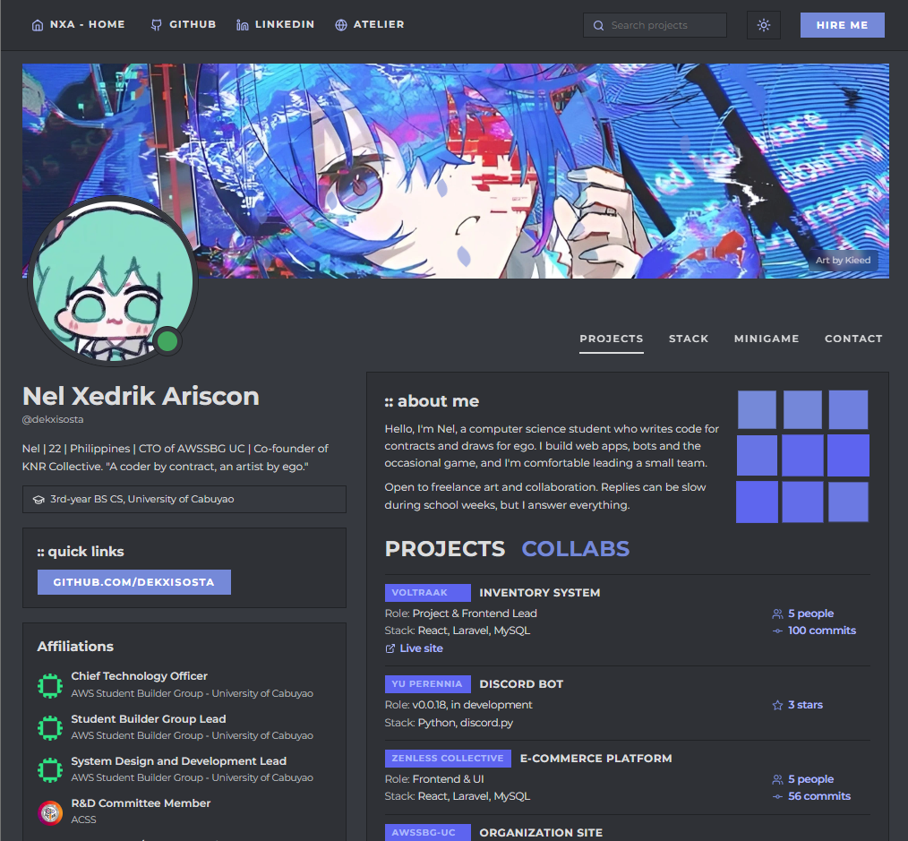

# Dev Portfolio


Personal portfolio website featuring project showcase, tech stack, and an interactive Whack-a-Miku minigame.



## Features

- Projects and collaborations showcase
- Tech stack display with categorization
- Dark/light theme toggle
- Responsive mobile design with hamburger menu
- Contact form via Formspree
- Whack-a-Miku minigame with fever mode and high score tracking

## Installation

```bash
git clone https://github.com/Dekxisosta/dev-portfolio.git
cd dev-portfolio
npm install
cp .env.example .env
# Add your Formspree form ID to .env
npm run dev
```

## Configuration

Create `.env` file:

```env
VITE_FORMSPREE_FORM_ID=your_form_id_here
```

Update portfolio data in `src/data.js`.

Replace images in `public/images/` directories.

## Build

```bash
npm run build
```

## Tech Stack

React 18, Vite 5, Custom CSS, Lucide Icons, Formspree

## License

MIT

## Contact

rroquxii@gmail.com | [GitHub](https://github.com/Dekxisosta) | [LinkedIn](https://www.linkedin.com/in/nel-xedrik-ariscon-9b7a40387/)
